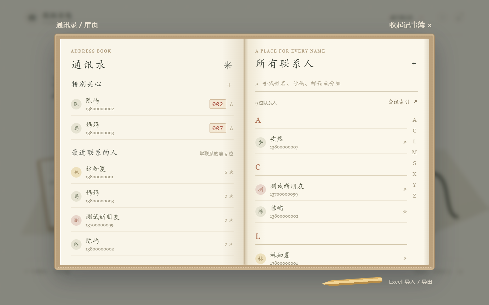

# 验证记录

验证日期：2026 年 11 月 16 日。运行环境：Windows、本机 Chrome、Node.js 24；项目声明的最低 Node.js 版本为 20，但本记录不声称已验证所有 Node.js 版本或浏览器。

## 自动测试

运行 `node --test`，共 **12 项通过、0 项失败**：

- 联系方式归一化、跨联系人号码冲突和邮箱校验。
- Excel 导入合并保留原联系方式、备注、收藏和统计。
- 无姓名、冲突号码、非法邮箱与社交账号格式的错误处理。
- 真实 `.xlsx` 编解码往返，保留前导零、多账号、换行备注和收藏。
- 常见中文、英文姓名的字母索引。
- 三位短码的格式、唯一性、前导零与拨号匹配。
- 短码 Excel 映射、旧格式兼容及冲突保护。
- 最近整圈选择、各数字吸附、相邻档位滞回、0/1 空白扇区和跨圈连续性（5 项）。

测试源码见 [`tests/data.test.mjs`](../tests/data.test.mjs) 和 [`tests/dial.test.mjs`](../tests/dial.test.mjs)。

## 最终拨号交互检查

用独立浏览器上下文和虚构示例联系人，执行了以下 6 项浏览器检查，全部通过：

1. 拖到数字后松手，盘面和中心数字保留；停留 1 秒只录入一次。
2. 再次选择同一数字，能够连续输入 `11` 和 `00`。
3. 末次操作后 3.5 秒仍保留，超过 4 秒后清空号码并复位。
4. 继续操作重计时；跨数字、松手、移开鼠标均不隐藏气泡；点击转盘外才收起。
5. 气泡内输入、退格、清空不会被外部点击规则干扰。
6. 三位短码及完整的 11 位号码，按 2 秒等待与 1 秒响铃打开对应联系人。

此前也检查过多联系方式自动保存、重复号码阻止保存、分组操作、Excel 文件导出后重新导入，以及手机页面无横向溢出。后续修改应按受影响功能复测。

## 界面截图

截图仅含虚构示例与自动化测试记录，不代表两名同学的个人贡献或提交历史。博客仍需要各自的 Git 截图和完整演示视频。

### 首页

### 转盘吸附与号码输入

### 通讯录与特别关心短码

## 验证边界

- 联系人存于当前浏览器，不提供云端同步；本机地址不能用于云部署加分。
- 未执行真实电话呼叫。
- 测试结果不替代指定仓库 Fork、两人实际编码、真实 PSP、个人博客和演示视频。
